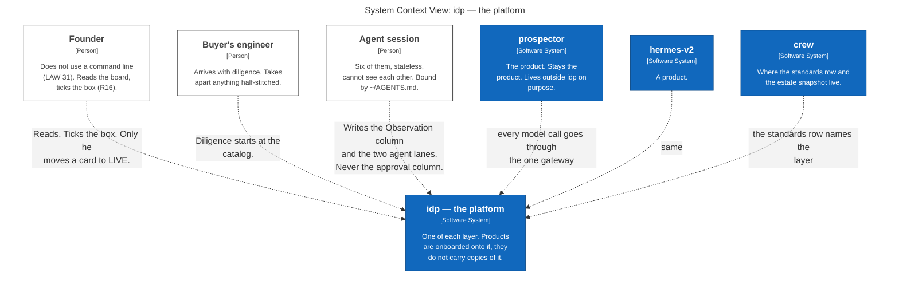
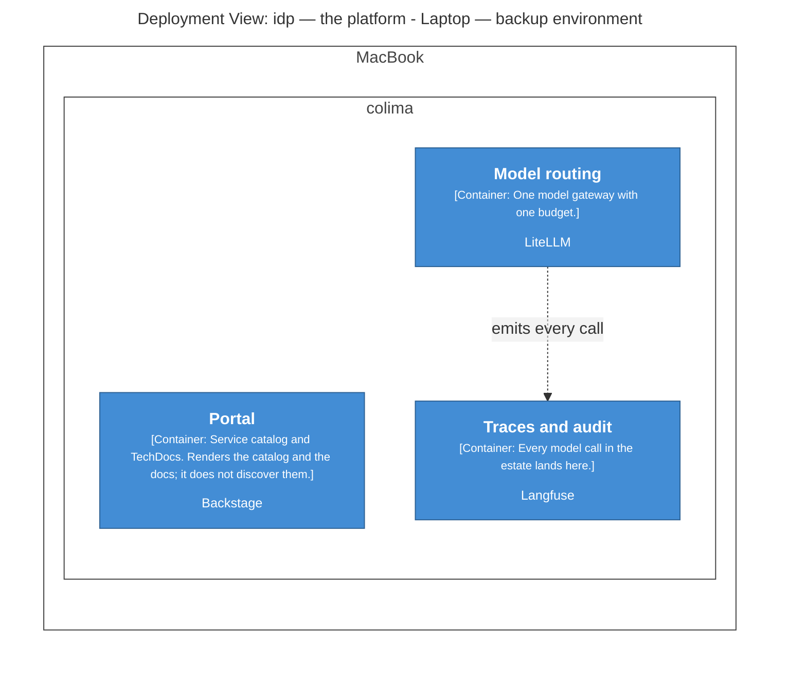
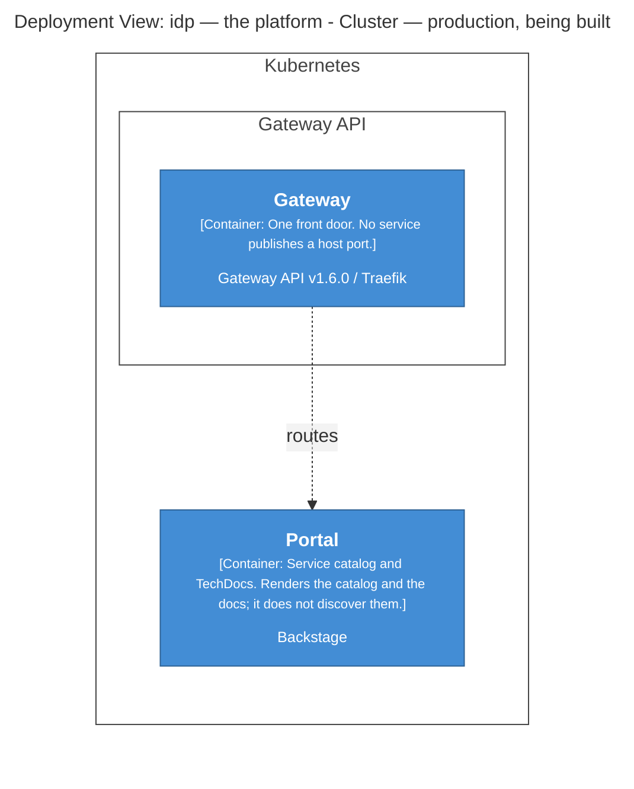

# Architecture

Generated by `architecture/render` from `architecture/workspace.dsl`. Do not edit this
file. Edit the model and run `make diagrams`.

The model is C4. Each heading below is one view of the same model, so the boxes cannot
disagree with each other the way four hand-drawn pictures do.

## Context

## Containers

```mermaid
graph LR
  linkStyle default fill:#ffffff

  subgraph diagram ["Container View: idp — the platform"]
    style diagram fill:#ffffff,stroke:#ffffff

    1["<div style='font-weight: bold'>Founder</div><div style='font-size: 70%; margin-top: 0px'>[Person]</div><div style='font-size: 80%; margin-top:10px'>Does not use a command line<br />(LAW 31). Reads the board,<br />ticks the box (R16).</div>"]
    style 1 fill:#ffffff,stroke:#444444,color:#444444
    2["<div style='font-weight: bold'>Buyer's engineer</div><div style='font-size: 70%; margin-top: 0px'>[Person]</div><div style='font-size: 80%; margin-top:10px'>Arrives with diligence. Takes<br />apart anything half-stitched.</div>"]
    style 2 fill:#ffffff,stroke:#444444,color:#444444
    3["<div style='font-weight: bold'>Agent session</div><div style='font-size: 70%; margin-top: 0px'>[Person]</div><div style='font-size: 80%; margin-top:10px'>Six of them, stateless,<br />cannot see each other. Bound<br />by ~/AGENTS.md.</div>"]
    style 3 fill:#ffffff,stroke:#444444,color:#444444
    25["<div style='font-weight: bold'>prospector</div><div style='font-size: 70%; margin-top: 0px'>[Software System]</div><div style='font-size: 80%; margin-top:10px'>The product. Stays the<br />product. Lives outside idp on<br />purpose.</div>"]
    style 25 fill:#1168bd,stroke:#0b4884,color:#ffffff
    26["<div style='font-weight: bold'>hermes-v2</div><div style='font-size: 70%; margin-top: 0px'>[Software System]</div><div style='font-size: 80%; margin-top:10px'>A product.</div>"]
    style 26 fill:#1168bd,stroke:#0b4884,color:#ffffff
    27["<div style='font-weight: bold'>crew</div><div style='font-size: 70%; margin-top: 0px'>[Software System]</div><div style='font-size: 80%; margin-top:10px'>Where the standards row and<br />the estate snapshot live.</div>"]
    style 27 fill:#1168bd,stroke:#0b4884,color:#ffffff

    subgraph 4 ["idp — the platform"]
      style 4 fill:#ffffff,stroke:#0b4884,color:#0b4884

      10["<div style='font-weight: bold'>Secrets</div><div style='font-size: 70%; margin-top: 0px'>[Container: secrets/<env>/<name>.yaml, private repo, never a value in a log.]</div><div style='font-size: 80%; margin-top:10px'>sops + age directory vault</div>"]
      style 10 fill:#438dd5,stroke:#2e6295,color:#ffffff
      11["<div style='font-weight: bold'>Scheduling</div><div style='font-size: 70%; margin-top: 0px'>[Container: One scheduler. launchd is the substrate's supervisor, not the estate's scheduler.]</div><div style='font-size: 80%; margin-top:10px'>Dagster</div>"]
      style 11 fill:#438dd5,stroke:#2e6295,color:#ffffff
      12["<div style='font-weight: bold'>CI</div><div style='font-size: 70%; margin-top: 0px'>[Container: The gate. A repo with no CI gets a gate before it gets a merge.]</div><div style='font-size: 80%; margin-top:10px'>GitHub Actions</div>"]
      style 12 fill:#438dd5,stroke:#2e6295,color:#ffffff
      13["<div style='font-weight: bold'>Catalog source</div><div style='font-size: 70%; margin-top: 0px'>[Container: Generates catalog-info.yaml from the LAW 39 inventory. Never hand-edited.]</div><div style='font-size: 80%; margin-top:10px'>idp/bin/catalog-gen</div>"]
      style 13 fill:#438dd5,stroke:#2e6295,color:#ffffff
      14["<div style='font-weight: bold'>Docs tree</div><div style='font-size: 70%; margin-top: 0px'>[Container: Lives beside the code it describes. Rendered by the portal.]</div><div style='font-size: 80%; margin-top:10px'>Markdown, Diataxis, MkDocs</div>"]
      style 14 fill:#438dd5,stroke:#2e6295,color:#ffffff
      15["<div style='font-weight: bold'>Greenlane</div><div style='font-size: 70%; margin-top: 0px'>[Container: The gated trunk: a serial trunk that batches, bisects and lands a PR only when its required checks passed at that exact sha (I1).]</div><div style='font-size: 80%; margin-top:10px'>greenlane/engine.py</div>"]
      style 15 fill:#438dd5,stroke:#2e6295,color:#ffffff
      16["<div style='font-weight: bold'>Event spine</div><div style='font-size: 70%; margin-top: 0px'>[Container: The environment emits facts and an agent responds: Flux -> NATS JetStream -> the bridge -> Temporal -> a receipt.]</div><div style='font-size: 80%; margin-top:10px'>spine/, spine/bridge.py</div>"]
      style 16 fill:#438dd5,stroke:#2e6295,color:#ffffff
      17["<div style='font-weight: bold'>Factory</div><div style='font-size: 70%; margin-top: 0px'>[Container: Collects the estate's capabilities into the registry the catalogue reads.]</div><div style='font-size: 80%; margin-top:10px'>factory/</div>"]
      style 17 fill:#438dd5,stroke:#2e6295,color:#ffffff
      18["<div style='font-weight: bold'>Census</div><div style='font-size: 70%; margin-top: 0px'>[Container: Runs the collectors, joins what they saw, and says what is missing: MANAGED or UNCATALOGUED with a reason.]</div><div style='font-size: 80%; margin-top:10px'>catalog/census/</div>"]
      style 18 fill:#438dd5,stroke:#2e6295,color:#ffffff
      19["<div style='font-weight: bold'>Operating model policy</div><div style='font-size: 70%; margin-top: 0px'>[Container: The estate-as-platform rules as a gate rather than a paragraph: the founder approves, agents implement.]</div><div style='font-size: 80%; margin-top:10px'>policy/operating_model.rego</div>"]
      style 19 fill:#438dd5,stroke:#2e6295,color:#ffffff
      20["<div style='font-weight: bold'>Executor</div><div style='font-size: 70%; margin-top: 0px'>[Container: The executor daemon. Every agent's tool calls go through this door; without it no agent can run a command.]</div><div style='font-size: 80%; margin-top:10px'>catalog/critical-functions.json<br />(executor)</div>"]
      style 20 fill:#438dd5,stroke:#2e6295,color:#ffffff
      21["<div style='font-weight: bold'>Estate bus</div><div style='font-size: 70%; margin-top: 0px'>[Container: The event bus. State is streamed over it; without it the surfaces go stale and agents cannot be told what happened.]</div><div style='font-size: 80%; margin-top:10px'>catalog/critical-functions.json<br />(estate-bus)</div>"]
      style 21 fill:#438dd5,stroke:#2e6295,color:#ffffff
      22["<div style='font-weight: bold'>Memory plane</div><div style='font-size: 70%; margin-top: 0px'>[Container: The estate's single memory plane: brief, recall, remember.]</div><div style='font-size: 80%; margin-top:10px'>catalog/critical-functions.json<br />(memory-plane)</div>"]
      style 22 fill:#438dd5,stroke:#2e6295,color:#ffffff
      23["<div style='font-weight: bold'>Critical lanes</div><div style='font-size: 70%; margin-top: 0px'>[Container: The estate's critical lanes as data. A home is a failure domain: a place the service runs that can die without taking the others with it.]</div><div style='font-size: 80%; margin-top:10px'>platform/ladder/critical-lanes.json</div>"]
      style 23 fill:#438dd5,stroke:#2e6295,color:#ffffff
      24["<div style='font-weight: bold'>Probes</div><div style='font-size: 70%; margin-top: 0px'>[Container: What the drills assert, as code: the front door, the catalogue, Langfuse, Signoz, the backstages.]</div><div style='font-size: 80%; margin-top:10px'>probes/</div>"]
      style 24 fill:#438dd5,stroke:#2e6295,color:#ffffff
      5["<div style='font-weight: bold'>Board</div><div style='font-size: 70%; margin-top: 0px'>[Container: STANDARDS row 27. R16 governance as checkbox rows; ticking a box is an act. Kanboard retired 2026-08-26 (crew#282).]</div><div style='font-size: 80%; margin-top:10px'>GitHub Issues,<br />chidionyema/crew</div>"]
      style 5 fill:#438dd5,stroke:#2e6295,color:#ffffff
      6["<div style='font-weight: bold'>Portal</div><div style='font-size: 70%; margin-top: 0px'>[Container: Service catalog and TechDocs. Renders the catalog and the docs; it does not discover them.]</div><div style='font-size: 80%; margin-top:10px'>Backstage</div>"]
      style 6 fill:#438dd5,stroke:#2e6295,color:#ffffff
      7["<div style='font-weight: bold'>Gateway</div><div style='font-size: 70%; margin-top: 0px'>[Container: One front door. No service publishes a host port.]</div><div style='font-size: 80%; margin-top:10px'>Gateway API v1.6.0 / Traefik</div>"]
      style 7 fill:#438dd5,stroke:#2e6295,color:#ffffff
      8["<div style='font-weight: bold'>Model routing</div><div style='font-size: 70%; margin-top: 0px'>[Container: One model gateway with one budget.]</div><div style='font-size: 80%; margin-top:10px'>LiteLLM</div>"]
      style 8 fill:#438dd5,stroke:#2e6295,color:#ffffff
      9["<div style='font-weight: bold'>Traces and audit</div><div style='font-size: 70%; margin-top: 0px'>[Container: Every model call in the estate lands here.]</div><div style='font-size: 80%; margin-top:10px'>Langfuse</div>"]
      style 9 fill:#438dd5,stroke:#2e6295,color:#ffffff
    end

    1-. "<div>Reads. Ticks the box. Only he<br />moves a card to LIVE.</div><div style='font-size: 70%'></div>" .->5
    1-. "<div>Reads what exists and what<br />depends on what.</div><div style='font-size: 70%'></div>" .->6
    2-. "<div>Diligence starts at the<br />catalog.</div><div style='font-size: 70%'></div>" .->6
    3-. "<div>Writes the Observation column<br />and the two agent lanes.<br />Never the approval column.</div><div style='font-size: 70%'></div>" .->5
    3-. "<div>Opens the PR. The gate<br />decides, not the agent.</div><div style='font-size: 70%'></div>" .->12
    7-. "<div>routes</div><div style='font-size: 70%'></div>" .->6
    7-. "<div>routes</div><div style='font-size: 70%'></div>" .->9
    7-. "<div>routes</div><div style='font-size: 70%'></div>" .->8
    6-. "<div>reads the generated entities</div><div style='font-size: 70%'></div>" .->13
    6-. "<div>renders via TechDocs</div><div style='font-size: 70%'></div>" .->14
    8-. "<div>emits every call</div><div style='font-size: 70%'></div>" .->9
    8-. "<div>reads provider keys</div><div style='font-size: 70%'></div>" .->10
    11-. "<div>triggers</div><div style='font-size: 70%'></div>" .->12
    12-. "<div>reads, never prints</div><div style='font-size: 70%'></div>" .->10
    15-. "<div>grades the PR; lands by<br />squash only when green</div><div style='font-size: 70%'></div>" .->12
    15-. "<div>writes the observation, never<br />the approval</div><div style='font-size: 70%'></div>" .->5
    16-. "<div>the fabric between the<br />environment and the agent's<br />clock</div><div style='font-size: 70%'></div>" .->21
    17-. "<div>collects the capabilities the<br />catalogue publishes</div><div style='font-size: 70%'></div>" .->13
    18-. "<div>joins what it saw against the<br />catalogue</div><div style='font-size: 70%'></div>" .->13
    19-. "<div>the rules the gated trunk<br />enforces</div><div style='font-size: 70%'></div>" .->15
    24-. "<div>measures each lane; the drill<br />decides health</div><div style='font-size: 70%'></div>" .->23
    23-. "<div>the published hostnames</div><div style='font-size: 70%'></div>" .->7
    20-. "<div>runs a command under scoped<br />authority</div><div style='font-size: 70%'></div>" .->10
    22-. "<div>state is streamed, not polled</div><div style='font-size: 70%'></div>" .->21
    8-. "<div>the lanes the running router<br />serves</div><div style='font-size: 70%'></div>" .->23
    25-. "<div>every model call goes through<br />the one gateway</div><div style='font-size: 70%'></div>" .->8
    25-. "<div>every trace lands in the one<br />collector</div><div style='font-size: 70%'></div>" .->9
    25-. "<div>one vault</div><div style='font-size: 70%'></div>" .->10
    25-. "<div>is an entity in the one<br />catalog</div><div style='font-size: 70%'></div>" .->13
    26-. "<div>same</div><div style='font-size: 70%'></div>" .->8
    26-. "<div>same</div><div style='font-size: 70%'></div>" .->9
    27-. "<div>the standards row names the<br />layer</div><div style='font-size: 70%'></div>" .->13

  end
```

## Laptop

## Cluster

## Control-path

```mermaid
graph LR
  linkStyle default fill:#ffffff

  subgraph diagram ["Container View: idp — the platform"]
    style diagram fill:#ffffff,stroke:#ffffff

    subgraph 4 ["idp — the platform"]
      style 4 fill:#ffffff,stroke:#0b4884,color:#0b4884

      10["<div style='font-weight: bold'>Secrets</div><div style='font-size: 70%; margin-top: 0px'>[Container: secrets/<env>/<name>.yaml, private repo, never a value in a log.]</div><div style='font-size: 80%; margin-top:10px'>sops + age directory vault</div>"]
      style 10 fill:#438dd5,stroke:#2e6295,color:#ffffff
      11["<div style='font-weight: bold'>Scheduling</div><div style='font-size: 70%; margin-top: 0px'>[Container: One scheduler. launchd is the substrate's supervisor, not the estate's scheduler.]</div><div style='font-size: 80%; margin-top:10px'>Dagster</div>"]
      style 11 fill:#438dd5,stroke:#2e6295,color:#ffffff
      12["<div style='font-weight: bold'>CI</div><div style='font-size: 70%; margin-top: 0px'>[Container: The gate. A repo with no CI gets a gate before it gets a merge.]</div><div style='font-size: 80%; margin-top:10px'>GitHub Actions</div>"]
      style 12 fill:#438dd5,stroke:#2e6295,color:#ffffff
      13["<div style='font-weight: bold'>Catalog source</div><div style='font-size: 70%; margin-top: 0px'>[Container: Generates catalog-info.yaml from the LAW 39 inventory. Never hand-edited.]</div><div style='font-size: 80%; margin-top:10px'>idp/bin/catalog-gen</div>"]
      style 13 fill:#438dd5,stroke:#2e6295,color:#ffffff
      15["<div style='font-weight: bold'>Greenlane</div><div style='font-size: 70%; margin-top: 0px'>[Container: The gated trunk: a serial trunk that batches, bisects and lands a PR only when its required checks passed at that exact sha (I1).]</div><div style='font-size: 80%; margin-top:10px'>greenlane/engine.py</div>"]
      style 15 fill:#438dd5,stroke:#2e6295,color:#ffffff
      16["<div style='font-weight: bold'>Event spine</div><div style='font-size: 70%; margin-top: 0px'>[Container: The environment emits facts and an agent responds: Flux -> NATS JetStream -> the bridge -> Temporal -> a receipt.]</div><div style='font-size: 80%; margin-top:10px'>spine/, spine/bridge.py</div>"]
      style 16 fill:#438dd5,stroke:#2e6295,color:#ffffff
      17["<div style='font-weight: bold'>Factory</div><div style='font-size: 70%; margin-top: 0px'>[Container: Collects the estate's capabilities into the registry the catalogue reads.]</div><div style='font-size: 80%; margin-top:10px'>factory/</div>"]
      style 17 fill:#438dd5,stroke:#2e6295,color:#ffffff
      18["<div style='font-weight: bold'>Census</div><div style='font-size: 70%; margin-top: 0px'>[Container: Runs the collectors, joins what they saw, and says what is missing: MANAGED or UNCATALOGUED with a reason.]</div><div style='font-size: 80%; margin-top:10px'>catalog/census/</div>"]
      style 18 fill:#438dd5,stroke:#2e6295,color:#ffffff
      19["<div style='font-weight: bold'>Operating model policy</div><div style='font-size: 70%; margin-top: 0px'>[Container: The estate-as-platform rules as a gate rather than a paragraph: the founder approves, agents implement.]</div><div style='font-size: 80%; margin-top:10px'>policy/operating_model.rego</div>"]
      style 19 fill:#438dd5,stroke:#2e6295,color:#ffffff
      20["<div style='font-weight: bold'>Executor</div><div style='font-size: 70%; margin-top: 0px'>[Container: The executor daemon. Every agent's tool calls go through this door; without it no agent can run a command.]</div><div style='font-size: 80%; margin-top:10px'>catalog/critical-functions.json<br />(executor)</div>"]
      style 20 fill:#438dd5,stroke:#2e6295,color:#ffffff
      21["<div style='font-weight: bold'>Estate bus</div><div style='font-size: 70%; margin-top: 0px'>[Container: The event bus. State is streamed over it; without it the surfaces go stale and agents cannot be told what happened.]</div><div style='font-size: 80%; margin-top:10px'>catalog/critical-functions.json<br />(estate-bus)</div>"]
      style 21 fill:#438dd5,stroke:#2e6295,color:#ffffff
      22["<div style='font-weight: bold'>Memory plane</div><div style='font-size: 70%; margin-top: 0px'>[Container: The estate's single memory plane: brief, recall, remember.]</div><div style='font-size: 80%; margin-top:10px'>catalog/critical-functions.json<br />(memory-plane)</div>"]
      style 22 fill:#438dd5,stroke:#2e6295,color:#ffffff
      23["<div style='font-weight: bold'>Critical lanes</div><div style='font-size: 70%; margin-top: 0px'>[Container: The estate's critical lanes as data. A home is a failure domain: a place the service runs that can die without taking the others with it.]</div><div style='font-size: 80%; margin-top:10px'>platform/ladder/critical-lanes.json</div>"]
      style 23 fill:#438dd5,stroke:#2e6295,color:#ffffff
      24["<div style='font-weight: bold'>Probes</div><div style='font-size: 70%; margin-top: 0px'>[Container: What the drills assert, as code: the front door, the catalogue, Langfuse, Signoz, the backstages.]</div><div style='font-size: 80%; margin-top:10px'>probes/</div>"]
      style 24 fill:#438dd5,stroke:#2e6295,color:#ffffff
      5["<div style='font-weight: bold'>Board</div><div style='font-size: 70%; margin-top: 0px'>[Container: STANDARDS row 27. R16 governance as checkbox rows; ticking a box is an act. Kanboard retired 2026-08-26 (crew#282).]</div><div style='font-size: 80%; margin-top:10px'>GitHub Issues,<br />chidionyema/crew</div>"]
      style 5 fill:#438dd5,stroke:#2e6295,color:#ffffff
      7["<div style='font-weight: bold'>Gateway</div><div style='font-size: 70%; margin-top: 0px'>[Container: One front door. No service publishes a host port.]</div><div style='font-size: 80%; margin-top:10px'>Gateway API v1.6.0 / Traefik</div>"]
      style 7 fill:#438dd5,stroke:#2e6295,color:#ffffff
    end

    11-. "<div>triggers</div><div style='font-size: 70%'></div>" .->12
    12-. "<div>reads, never prints</div><div style='font-size: 70%'></div>" .->10
    15-. "<div>grades the PR; lands by<br />squash only when green</div><div style='font-size: 70%'></div>" .->12
    15-. "<div>writes the observation, never<br />the approval</div><div style='font-size: 70%'></div>" .->5
    16-. "<div>the fabric between the<br />environment and the agent's<br />clock</div><div style='font-size: 70%'></div>" .->21
    17-. "<div>collects the capabilities the<br />catalogue publishes</div><div style='font-size: 70%'></div>" .->13
    18-. "<div>joins what it saw against the<br />catalogue</div><div style='font-size: 70%'></div>" .->13
    19-. "<div>the rules the gated trunk<br />enforces</div><div style='font-size: 70%'></div>" .->15
    24-. "<div>measures each lane; the drill<br />decides health</div><div style='font-size: 70%'></div>" .->23
    23-. "<div>the published hostnames</div><div style='font-size: 70%'></div>" .->7
    20-. "<div>runs a command under scoped<br />authority</div><div style='font-size: 70%'></div>" .->10
    22-. "<div>state is streamed, not polled</div><div style='font-size: 70%'></div>" .->21

  end
```

Decision: [0002 - documentation is code and the portal renders it](../decisions/0002-documentation-is-code-and-the-portal-renders-it.md)
