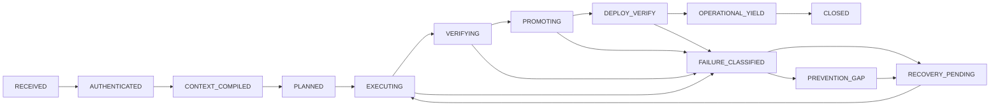

# FLOW — Fractal Lifecycle of Operational Work

**Contract:** IDP #7771. **Failure-class prevention:** IDP #7452. **Continuity:** IDP #7790. **Admission:** IDP #7794. **Founder visibility:** Argon #62/#47. **Execution authority:** existing Temporal, claim, DoF, Greenlane, Flux and independent verification. This file is a protocol, not a new control plane.

## Foundational invariant

Every instruction, child task, incident, review, recovery action and platform-improvement obligation is a **FLOW node**. Each carries `instruction_id, node_id, parent_id, request_id, workflow_id, run_id, contract_version, plan_hash, source_sha, authority_epoch, owner, deadline, failure_class_id, expected_effect, predicates, last_productive_at, current_state, next_action, evidence_ref, recovery_budget, maturity`. Authoritative values come from existing systems; **no duplicate ledger**. The node's children are the same type recursively. Parents join only independently witnessed child results; children cannot enlarge their inherited permissions or budgets.

A node **never silently disappears**. It either delivers independently verified operational yield, remains in durably owned recovery, is explicitly cancelled with authority, or records a proven, actionable nondelegable block. A green CI run, completed workflow, issue, commit, reviewer comment, model assertion or HTTP 200 alone is never operational yield.

## State machine

Transition rules:

| Transition | Required evidence; actual owner |
|---|---|
| RECEIVED → AUTHENTICATED | Trusted gateway principal and idempotency key; never self-asserted browser identity |
| AUTHENTICATED → CONTEXT_COMPILED | Canonical capability, dependency, policy, current memory and correction lookup, source-bound plan |
| CONTEXT_COMPILED → PLANNED | BDD predicates, ticket/claim, authority lease, budgets, risk and safe compensator |
| PLANNED → EXECUTING | Verified capacity offer and fencing epoch on existing Temporal executor |
| EXECUTING → VERIFYING | Bounded action receipt with exact revision; no double external effect on retry |
| VERIFYING → PROMOTING | Independent reviewer/probe and security/DoF/Greenlane authorization |
| PROMOTING → DEPLOY_VERIFY | Attested release SHA/config; Flux or existing approved delivery path |
| DEPLOY_VERIFY → OPERATIONAL_YIELD | Real caller exercises exact release; independent current result, timestamp and TTL |
| OPERATIONAL_YIELD → CLOSED | Root-cause/prevention class adopted or explicitly nonrecurrent, durable learning and **independent founder-visible readback** |
| Any active → FAILURE_CLASSIFIED | Failure fingerprint, precise source, persisted checkpoint, owner, eligible recovery action; not a blank 'blocked' |
| FAILURE_CLASSIFIED → RECOVERY_PENDING | Reuse **existing FCR** correction if verified; otherwise root-cause investigation **once**, regression falsifier and prevention plan |
| RECOVERY_PENDING → EXECUTING | Authorized distinct hypothesis/eligible alternate, fence increment, budget, deadline, effect reconciliation |
| Any active → QUARANTINED / BLIND | Missing/revoked identity, stale lease, absent/expired evidence or dead observer; no fake green |

## Closed-loop supervisor (always running in existing machinery)

The existing incident/event/Temporal operators sense failures and meaningful progress, classify and dedupe, atomically assign a single owner, select the *next permitted* action, execute or hand over, independently verify the actual effect, commit the correction/intelligence, and reconcile the Founder Surface. A model context or browser tab never holds authoritative workflow custody. **>=600 seconds without genuine progress** triggers a typed stagnation fault; heartbeat, PR comment, timestamp refresh, rerun or ticket creation does not reset it. Use source-owned clocks and current HEAD.

**One failure class, one diagnostic investment.** The existing FCR #7452 owns the stable class fingerprint and independently versioned class correction. The first encounter investigates root cause, tests a reproducer and fixes the *class*, not only an instance. Every future encounter must retrieve and apply the validated correction. A failed correction or repeated identical attempt is **PREVENTION_GAP** and triggers one owner for the control deficiency plus a new bounded hypothesis, not another identical guess. Two unsuccessful identical attempts is a hard cap, **never** an instruction to loop twice automatically. Preserve original attempts, logs and effects; enforce idempotency, old-lease rejection, independent attestation, and compensation. No privileged operation merely because an agent said it was allowed.

Recovery is suspended as `RECOVERY_PENDING` when real capacity/authority is unavailable, with a durable checkpoint and independently scheduled retry. Founder only sees a decision when it truly needs nondelegable authority or material risk judgment; no repeat status narration.

## Yield and inherited intelligence

Separate **session yield** (verified engineering delta, friction found/removed, reusable intelligence, tests, optimisation, explicit maturity) from **operational yield** (effect actually used by real caller, exact deployment, independent witness). Each finished node emits structured evidence and submits new lessons to the **existing memory and FCR authority**, which must be retrievable, applied by a different agent and reverified to count as fleet-wide adoption. The regression test and fault injection must prevent the same class from recurring silently. Unobserved deployment is UNKNOWN, not yield.

## Founder visibility is part of the transaction

Argon #62 must project this same graph via the existing Genesis/ Otto read model: parent/child nodes, exact state and runtime SHA, current owner/lease, productive age, pending verification, recovery action/ETA when grounded, class correction version/adoption, evidence age, failure/blindness, costs and independent final receipt. Reconcile all declared capabilities in **both directions**: source obligations missing from the UI, and displayed claims missing authoritative source evidence. The observer must itself be independently probed; no silent monitoring loss or fixture-based green. UI feedback to a founder action is receipt-bound; page refresh resumes the **same** workflow. A broken Founder Surface produces its own FLOW node and an out-of-band alarm.

## Executable falsifiers before enforcement

1. Report the same incident twice: one ticket, one dispatch; repeats return the original custody ref.
2. Manually close an issue with no verified source effect: no FLOW completion.
3. At 599/600 seconds true no-progress, inspect timer behavior; unchanged heartbeat cannot prevent the 600-second recovery.
4. Reintroduce a resolved fault in a different provider/session: inheriting correction prevents second diagnosis, and recurrence is classified PREVENTION_GAP.
5. Crash worker / exhaust context / duplicate event / lose NATS: checkpoint persists, stale fence refused, no duplicate effects or founder courier.
6. Fake green, expired proof, lost observer, stale deployment SHA or missing founder route: BLIND and owned recovery, not completion.
7. Genuine instruction-to-yield canary: trusted request → compiled plan → green governed release → independently exercised effect → adopted class correction → Founder Surface readback, with exact SHA, proof times, rollback and cost.

**Rollout:** first repair existing incident-loop idempotence and publish read-only FLOW projections; then shadow-classify and reconcile FCR/Founder Surface; then demonstrate live correction inheritance, 600-second response and external canaries; only then enforce new completion gates. Security boundaries are always enforced. A source commit or green candidate does not certify deployed operation.
