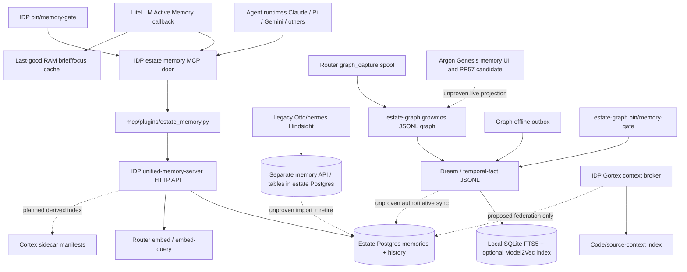

# Memory topology: source, operating evidence, claims and unresolved composition (2026-11-09)

**Nature:** source-backed vertical-slice baseline, **NOT a live runtime audit or a new architecture proposal**. Owner of the existing audit: [#7480](https://github.com/chidionyema/idp/issues/7480); overarching memory programme [#6165](https://github.com/chidionyema/idp/issues/6165). Investigated repositories: `chidionyema/idp`, `chidionyema/argon`, `chidionyema/estate-graph` on their current GitHub `main` trees. Source inventory includes filename/subject matches, GitHub issue searches, selected implementation read-through and linked Actions runs. It **cannot** enumerate every unindexed local runtime, raw session transcript or privately held data. No production memory credentials or Postgres read were available; current live status is therefore **UNKNOWN** unless a time-stamped real-caller receipt is cited.

## A. Measured discovery scope

- IDP `main`: 8,039 tree objects; **139 blob paths** whose names match `memory|memgraph|dream|hindsight|cortex|gortex|growmos|focus|recall|embedd|context-broker`. These are not 139 independently running systems. The broader IDP tree has a further set of generic context, router and platform files outside that filename filter.
- `estate-graph/main`: 778 tree objects; **91 matching blob paths** (including tracked `.growmos` source data, tests and `state/dream`). It is not 91 services.
- `argon/main`: 1,396 tree objects; **2 matching blob paths**. This is a false-negative-prone filename scan: its generic state/protocol code also handles memory. Argon PR #57 is **OPEN**, not deployed by virtue of its branch.
- GitHub issue search `repo:chidionyema/idp memory in:title,body type:issue`: **120 matches** on 2026-11-09, open and closed. `argon` returned 7 and `estate-graph` 1. These keyword matches may include irrelevant 'memory exhaustion' reports and omit related work using other terms. The full issue/claims boundary must be searched by dependency as well as keyword. **Do not present these numbers as an exhaustive semantic inventory.**

## B. Current source topology — not a runtime diagram

**Line semantics:** solid lines indicate interfaces or reads/writes established by inspected source; dashed lines identify intended or missing *operational* integration. No solid line should be interpreted as a currently healthy service without a live effect receipt.

## C. Component-by-component baseline

| Id | Implementation / responsible repository | Persisted authority / purpose | Evidence status |
| --- | --- | --- | --- |
| M1 | IDP `platform/unified-memory-server/main.py`, `schema.sql`, `harness.py` | Declared system of record: Postgres `memories`, `memory_versions`; embedding, provenance, consolidation and temporal APIs | Source present; actual cloud service and DB availability **UNKNOWN** |
| M2 | IDP `platform/estate/memory/door.py`, `mcp/plugins/estate_memory.py`, `bin/estate-memory-mcp` | Shared agent `brief/recall/remember` interface. Uses `ESTATE_MEMORY_URL` and gateway credentials | Source present; [#7693](https://github.com/chidionyema/idp/issues/7693) records real TLS outage 31 Oct; **no later direct recovered-memory proof collected** |
| M3 | IDP `platform/llm/active_memory.py`, `platform/estate/memory/focus.py` | Context-time rank/injection, active focus and bounded RAM last-good cache | Source present; [#6835](https://github.com/chidionyema/idp/issues/6835) records thousands of failed router reads; no independent latest success |
| M4 | IDP `platform/hindsight/hindsight.yaml`, `platform/otto-gateway/memory-store-job.yaml` | Legacy Hindsight API/bank on estate Postgres, distinct service and model protocol | Manifests present; import [#6162](https://github.com/chidionyema/idp/issues/6162) and cleanup [#6163](https://github.com/chidionyema/idp/issues/6163) remain OPEN |
| M5 | IDP `platform/cortex/*` | Proposed replaceable derived Cortex hybrid index over memory records | Manifests present; [#6159](https://github.com/chidionyema/idp/issues/6159)/[#6160](https://github.com/chidionyema/idp/issues/6160) OPEN; no live Cortex receipt |
| M6 | IDP TypeScript `active-runtime/src/memory` and Python Postgres `unified-memory-server/harness.py` | ActiveMemoryEngine, scratchpad, approvals, typed per-turn prefetch | Multiple source implementations; use/adapters at runtime unknown |
| M7 | IDP `platform/llm/graph_capture.py`, `bin/estate-graph-drain` | Extract router transcripts into growmos graph from a spool | Source present; [#6666](https://github.com/chidionyema/idp/issues/6666) previously records gaps; latest real drained counts unknown |
| M8 | `estate-graph/.growmos/` | Source-derived graph entities, relations, journal, provenance | Tracked graph data; GitHub sync workflow sometimes succeeds and sometimes fails; not equivalent to IDP write/read recall |
| M9 | `estate-graph/bin/dream-cycle`, `bin/sync-temporal-memory` | Dream/consolidation and local temporal JSONL facts with separate keys/time semantics | Merged [PRs #7–#9](https://github.com/chidionyema/estate-graph/pulls?q=is%3Apr+is%3Amerged); [Memory v2 quality CI](https://github.com/chidionyema/estate-graph/actions/runs/42407199685) green, not live IDP integration |
| M10 | `estate-graph/bin/memory-index`, `bin/memory-retrieve` | Local SQLite FTS5 and optional sqlite-vec/Model2Vec; BM25/RRF with temporal/source scoring | Source/test implementation, actual production caller and data parity unproven |
| M11 | `estate-graph/bin/memory-outbox`, `bin/memory-gate` | Untrusted offline proposals; replay to local temporal facts; hash-linked local source-digest receipts | Source/test implementation, no evidence of authenticated Postgres replay |
| M12 | IDP `bin/memory-gate` | **Different tool with same name**: live `remember→recall` through MCP (while `--check` is a static check) | Source present; current full live gate result not independently obtained |
| M13 | IDP `platform/estate/context/`, Gortex and catalog | Source-code/context retrieval broker and impact index, not an alternative durable memory database | Distinct domain; integration [#7344](https://github.com/chidionyema/idp/issues/7344) OPEN |
| M14 | Argon Genesis `src/components/ProtocolStateMemoryView.tsx` and [PR #57](https://github.com/chidionyema/argon/pull/57) | UI renders MemoryEntry props, while PR proposes live Memory v2 status | UI source present; PR still OPEN, not proof of cross-plane delivery |
| M15 | IDP proposed `memory-snapshot` / R2 second-home pathway | Recovery snapshot and independent readback | [#7397](https://github.com/chidionyema/idp/issues/7397) remains OPEN; candidate snapshot paths not found in current IDP main tree; disaster recovery proof unknown |

## D. Overlaps versus actual differences

1. **Fact persistence:** IDP Postgres is the *declared* authoritative memory database; the growmos graph has different entity/edge provenance; estate-graph temporal JSONL is another writable fact dataset; Hindsight has a legacy bank. These are **overlapping data responsibilities**, not automatically four interchangeable stores. Missing evidence is an explicit ownership/reconciliation contract and conflict resolution.
2. **Retrieval:** IDP Postgres/pgvector, intended Cortex, Active Memory ranking/caches, estate-graph BM25/FTS5/optional vectors, and Gortex context indexing use different corpora and ranking contracts. Some should remain specialised; there is **no comparative benchmark proving an operational winner**.
3. **Context vs memory vs focus:** context brokerage selects bounded task sources; memory recalls durable historical facts; Active Focus projects current work/claims. Combining their names or endpoints is not semantic unification.
4. **Offline durability:** estate-graph outbox stores locally and replays into JSONL with quarantine. It is **not** proven to replay to IDP Postgres and authenticate publisher/tenant identity. Its SHA integrity is not an authority signature.
5. **Verification confusion:** two different `bin/memory-gate` programs measure *different invariants*. The same label on dashboards can therefore produce a false-green interpretation.
6. **Product projection:** Argon main has a memory UI, but its inputs are supplied by component props. The more substantial Memory v2 founder bridge is in an OPEN PR. A UI showing facts is not proof of an authoritative memory service.
7. **Cleanup failure:** IDP's 10-part memory epic [#6165](https://github.com/chidionyema/idp/issues/6165) is OPEN; its Hindsight migration and duplicate deletion are OPEN. The original five estate-graph PRs are also OPEN despite the later merged integration PRs. That is genuine lifecycle debt, not a claim that the five were never built.
8. **Failure domain:** [#7448](https://github.com/chidionyema/idp/issues/7448) and [#7693](https://github.com/chidionyema/idp/issues/7693) establish that independent-looking memory roads shared failed infrastructure (ingress/OKE). Current independent recovery is not established.

## E. Operational evidence classification

| Timestamp | Evidence | What it establishes — and what it does not |
| --- | --- | --- |
| 29–31 October | [Ingress #7448](https://github.com/chidionyema/idp/issues/7448), [memory #7693](https://github.com/chidionyema/idp/issues/7693) | Actual memory-route unavailability at that time. **Not a fresh 9 Nov probe** |
| 28–30 October | [Memory second-home #7397](https://github.com/chidionyema/idp/issues/7397) | Documented no independent working restore at time of investigation; proposed backup and fallback |
| 7 November | [Graph main Memory v2 CI](https://github.com/chidionyema/estate-graph/actions/runs/42407199685) | Tests of source on main passed; **does not prove live IDP store or agent behaviour** |
| 9 November | [Graph sync Actions 42539917483](https://github.com/chidionyema/estate-graph/actions/runs/42539917483) | One repository sync run succeeded; preceding run [42537531204](https://github.com/chidionyema/estate-graph/actions/runs/42537531204) failed; neither verifies Postgres memory convergence |
| 8–9 November | [Argon PR #57](https://github.com/chidionyema/argon/pull/57) | Candidate founder projection is open, not merged or deployed |

## F. Known work ownership and claims

- **Memory consolidation:** [#6165](https://github.com/chidionyema/idp/issues/6165), [#6162](https://github.com/chidionyema/idp/issues/6162), [#6163](https://github.com/chidionyema/idp/issues/6163).
- **Runtime clients and identity:** [#6156](https://github.com/chidionyema/idp/issues/6156), [#7794](https://github.com/chidionyema/idp/issues/7794); installer/session-hook claims do not prove every provider's first real turn.
- **Quality and effect-level checks:** [#6164](https://github.com/chidionyema/idp/issues/6164), [#7351](https://github.com/chidionyema/idp/issues/7351), [#7369](https://github.com/chidionyema/idp/issues/7369), [#7818](https://github.com/chidionyema/idp/issues/7818).
- **Independent home:** [#7397](https://github.com/chidionyema/idp/issues/7397), [#7693](https://github.com/chidionyema/idp/issues/7693).
- **Cross-plane source evidence:** [estate-graph #6](https://github.com/chidionyema/estate-graph/issues/6), [Genesis memory PR #57](https://github.com/chidionyema/argon/pull/57), [IDP #7480](https://github.com/chidionyema/idp/issues/7480).
- **One context broker:** [#7344](https://github.com/chidionyema/idp/issues/7344), a different data domain whose relation to memory must be explicit.

Historical `CLAIM agent=...` comments cover parts of [#7397](https://github.com/chidionyema/idp/issues/7397), [#7351](https://github.com/chidionyema/idp/issues/7351), [#6156](https://github.com/chidionyema/idp/issues/6156) and [#7794](https://github.com/chidionyema/idp/issues/7794). **Claim presence and heartbeat age are not proof of a currently working executor.** No claim is reassigned or displaced by this inventory.

## G. Minimal falsifiable comparison of the Fractal Factory hypothesis

Do not build a new memory system. Use this already-existing, overlapping product family as an experiment.

- **Fixed customer outcome:** a founder-authorised fact written through an operational estate door is recalled accurately and with its provenance by a second independently launched agent, including after host restart/outage, and is visible accurately in Genesis; tenant isolation and retention apply.
- **Baseline A:** the current disconnected system. Measure `P(write→cross-agent recall)`, p50/p95 latency, fresh data coverage, source-to-runtime delivery time, incident/repair minutes, number of independent write authorities, external dependencies, and real $/million successful requests.
- **Candidate B:** a composition of existing *proven* components satisfying that outcome. No default new datastore, framework, LLM, agent, registry or control plane; a component is optional if it cannot prove marginal value.
- **Decision test:** only prefer composition if it reaches real operational use with measurably better cost/reliability/time and no loss of provenance/security. Preserve loser source and research records; stop maintaining loser runtime paths when migration and rollback evidence exist.
- **Critical missing acceptance probes:** authenticate + write/read as two providers; restart/replay; prove graph-to-IDP synchronization or explicitly mark it a separate domain; import-and-shed Hindsight; restore from off-host backup; live Genesis view on exact SHA.

**Baseline conclusion:** the existence of shared functions has not delivered shared operational semantics. Recursion/production is not the scarce part. Evidence-backed selection, connection, deployment and retirement are the aspects of the theory still to falsify.

**Provenance boundary:** This report is assembled from current GitHub source and issue/CI metadata. It makes no claim that an unauthenticated HTTP request, static document, open PR, or green unit test certifies a currently running memory service.

## H. All discovered issue/CLAIM history — indexed evidence census (03:10 UTC, 9 Nov)

The underlying [machine-readable issue census](2026-11-09-memory-issues-census.json) now contains **all 144 GitHub issues matched by the enumerated search queries** (136 IDP, 7 Argon and 1 estate-graph), including states, titles and timestamps: **89 OPEN / 55 CLOSED**. The [claim-comment census](2026-11-09-memory-issue-claims-census.json) successfully inspected issue comments for **all 144**; no issue-comment fetch failed. This remains a *search-qualified* corpus, not an assertion that every relevant semantic issue in every repository was tagged/indexed or that PR review threads and agent-local sessions were included.

- **727 claim-line occurrences**, but only **245 distinct claim variants within their respective issues** after collapsing repeated heartbeat renewals. A claim variant is not an independently completed piece of work; identical claims on different tickets have not been globally deduplicated.
- **64 of 144 issues** had no parseable `CLAIM agent=` or `CLAIM W*` line at all; this does not prove they had no owner or work elsewhere.
- Among 89 OPEN issues, **37 lack a parseable heartbeat**, **48 have a last heartbeat older than two hours**, and only **4 have one within two hours** of the 03:10 UTC capture. These are *comment-age observations*, not a live claim lease verification. The newly submitted topology claim on #7480 is one of those four; it is not an additional independent executor.
- Example of activity-inflation: [#5522](https://github.com/chidionyema/idp/issues/5522) has **159 claim lines but one scoped claim variant**. [#6835](https://github.com/chidionyema/idp/issues/6835) has 76 lines but two variants. Counting heartbeats as delivered features is structurally wrong.
- The core unification ticket [#6165](https://github.com/chidionyema/idp/issues/6165), duplicate-shedding ticket [#6163](https://github.com/chidionyema/idp/issues/6163), recovered-door incident [#7693](https://github.com/chidionyema/idp/issues/7693) and failure atlas [#7818](https://github.com/chidionyema/idp/issues/7818) have no parseable recent ownership heartbeat **in their issue comments**. The separate onboarding ticket [#7794](https://github.com/chidionyema/idp/issues/7794) does have a recent claim but has not established operational memory continuity.

**Key managerial inference (not a measured deployment result):** the current issue/claim topology produces more signalling than independently verifiable progress, and fails to join multiple overlapping memory responsibilities into one tested customer outcome. The Fractal Factory hypothesis must be evaluated against this explicit baseline; adding another system would make the outcome worse unless it proves a measurable reduction in cost, dependency divergence and time to real use. No component is marked obsolete without source preservation, consumer migration, real-caller pass and rollback evidence.
